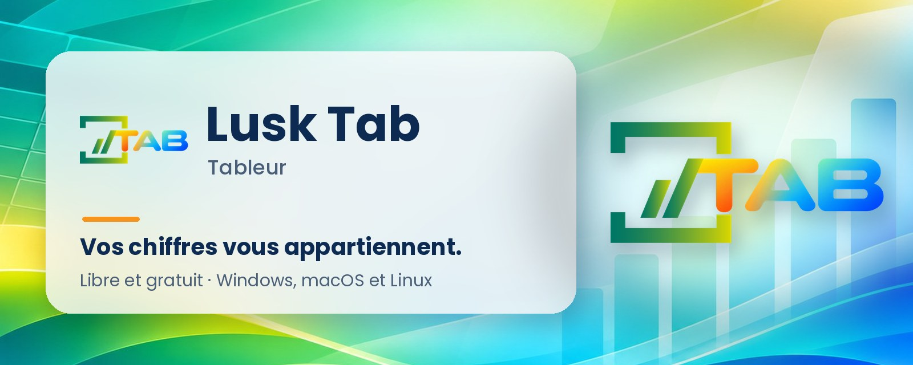

<p align="center">
  
</p>

<h3 align="center">Vos chiffres vous appartiennent.</h3>

<p align="center">
  Un tableur libre et gratuit, porté par l'association Lusk (loi 1901).<br>
  Pour Windows, macOS et Linux. Sans compte, sans publicité, et vos fichiers restent chez vous.
</p>

<p align="center">
  <a href="https://github.com/declic29/LuskTab/releases/latest/download/Lusk-Tab-Windows.msi"></a>
  <a href="https://github.com/declic29/LuskTab/releases/latest/download/Lusk-Tab-Mac.dmg"></a>
  <a href="https://github.com/declic29/LuskTab/releases/latest/download/Lusk-Tab-Linux.deb"></a>
</p>

<p align="center">
  <a href="https://github.com/declic29/LuskTab/releases/latest"></a>
  
  
  <a href="https://www.lusk.bzh"></a>
</p>

<p align="center">
  <a href="https://www.lusk.bzh"><b>lusk.bzh</b></a> ·
  <a href="https://github.com/declic29/LuskTab/releases">Toutes les versions</a> ·
  <a href="https://github.com/declic29/LuskOffice">Toute la suite avec Lusk Office</a> ·
  <a href="https://github.com/declic29/LuskTab/issues">Signaler un problème</a>
</p>

---

## Lusk Tab en bref

Lusk Tab est un tableur pour Windows, macOS et Linux. Il fonctionne entièrement sur votre
ordinateur : pas de compte, pas de publicité, pas de mesure d'audience, et vos classeurs ne sont
jamais envoyés nulle part.

- **Vos fichiers, dans les formats de tout le monde** : Excel (.xlsx, .xlsm), CSV et TSV ; import
  des fichiers .xlsb, .xls et OpenDocument (.ods) ; export PDF.
- **Un tableur complet** : des centaines de fonctions, mise en forme et mise en forme
  conditionnelle, tri et filtres, graphiques, tableaux croisés dynamiques, valeur cible, solveur et
  scénarios, macros.
- **En français d'abord**, avec les noms des fonctions en français (SOMME, SI, RECHERCHEV…).

## Télécharger et installer

Téléchargez la dernière version pour votre système :

| Système | Téléchargement |
|---|---|
| Windows (64 bits) | [**Lusk-Tab-Windows.msi**](https://github.com/declic29/LuskTab/releases/latest/download/Lusk-Tab-Windows.msi) |
| macOS (Apple et Intel) | [**Lusk-Tab-Mac.dmg**](https://github.com/declic29/LuskTab/releases/latest/download/Lusk-Tab-Mac.dmg) |
| Linux (toutes distributions) | [**Lusk-Tab-Linux.AppImage**](https://github.com/declic29/LuskTab/releases/latest/download/Lusk-Tab-Linux.AppImage) |
| Linux (Debian, Ubuntu, Mint) | [**Lusk-Tab-Linux.deb**](https://github.com/declic29/LuskTab/releases/latest/download/Lusk-Tab-Linux.deb) |

Les autres formats (version portable pour Windows sans installation, `.rpm` pour Fedora et
openSUSE, `.tar.gz`) et les versions précédentes sont sur la page
[Releases](https://github.com/declic29/LuskTab/releases).

`SHA256SUMS.txt` donne l'empreinte de chaque fichier, pour vérifier un téléchargement.

Une fois Lusk Tab installé, **Fichier › Mises à jour** cherche et installe les nouvelles
versions.

**Windows.** L'installeur, en français, propose « Pour moi seulement » (pour votre compte, sans
droits d'administrateur, dans `%LOCALAPPDATA%\Programs\Lusk\Lusk Tab`) ou « Pour tous les
utilisateurs de cet ordinateur » (dans `C:\Program Files\Lusk\Lusk Tab`, avec l'accord d'un
administrateur), puis un raccourci sur le Bureau (case cochée au départ).

**macOS.** Ouvrez le `.dmg` et glissez Lusk Tab dans Applications. L'application n'a pas de
certificat Apple : la première fois, macOS la bloque ; ouvrez **Réglages Système › Confidentialité
et sécurité**, puis cliquez sur **Ouvrir quand même**.

**Linux.** Rendez l'AppImage exécutable (`chmod +x`) puis lancez-la, ou installez le paquet de
votre distribution.

### Si Lusk Tab ne démarre pas

- **Windows, la fenêtre n'apparaît pas** : certains pilotes graphiques posent problème. Dans
  PowerShell, depuis le dossier du programme, essayez un autre moteur d'affichage :
  ```powershell
  $env:WGPU_BACKEND = "vulkan"
  & .\gridcraft.exe
  ```
  `WGPU_BACKEND` accepte aussi `dx12` et `gl`.
- Le **journal** se trouve dans `%APPDATA%\LuskTab\logs\` (Windows),
  `~/Library/Application Support/Lusk Tab/logs/` (macOS) ou `~/.config/lusk-tab/logs/` (Linux).
  Joignez-le à un signalement de problème.

## La suite Lusk

Lusk Tab fait partie de la suite libre et gratuite de l'association Lusk. Avec
**[Lusk Office](https://github.com/declic29/LuskOffice)**, un seul programme installe d'un coup les logiciels que vous cochez
(Windows, Linux et Mac).

<table>
  <tr>
    <td width="50%"><a href="https://github.com/declic29/LuskTX"></a></td>
    <td width="50%"><a href="https://github.com/declic29/Lusk-Diapo"></a></td>
  </tr>
  <tr>
    <td width="50%"><a href="https://github.com/declic29/Lusk_Pdf"></a></td>
    <td width="50%"><a href="https://www.lusk.bzh"></a></td>
  </tr>
</table>

## Compiler Lusk Tab

Il faut [Rust](https://rustup.rs) (version stable).

```sh
git clone https://github.com/declic29/LuskTab
cd LuskTab
cargo run --release -p gridcraft                       # l'application
cargo run --release -p gridcraft -- --sample budget    # avec un classeur d'exemple (sales, budget, grades)
cargo run --release -p gridcraft -- classeur.xlsx      # ouvrir un classeur
```

L'outil en ligne de commande calcule et convertit sans ouvrir l'application :

```sh
gridcraft-cli eval '=XLOOKUP("b",{"a","b"},{1,2})'      # → 2
gridcraft-cli cat classeur.xlsx --range B4:F15          # le contenu en texte
gridcraft-cli commands --search chart                   # les commandes disponibles
```

Avant chaque envoi, `cargo xtask ci` vérifie la mise en forme du code, les tests et les
attributions des images et polices.

## Licence et origine

Lusk Tab est un logiciel libre, sous licence [MIT](LICENSE-MIT) ou [Apache 2.0](LICENSE-APACHE),
au choix. © 2026 Lusk, association loi 1901.

Lusk Tab est dérivé de GridCraft, Copyright (c) 2026 ArtCraft Team and the GridCraft contributors,
publié sous les mêmes licences. Les mentions obligatoires sont dans [NOTICE](NOTICE), et l'auteur,
la source et la licence de chaque image et police sont dans [ATTRIBUTION.md](ATTRIBUTION.md).

Le logo de Lusk Tab appartient à l'association Lusk. Les classeurs d'exemple sont des contenus
originaux. Aucune icône ni image ne provient de Microsoft Office ou d'un autre logiciel commercial.
